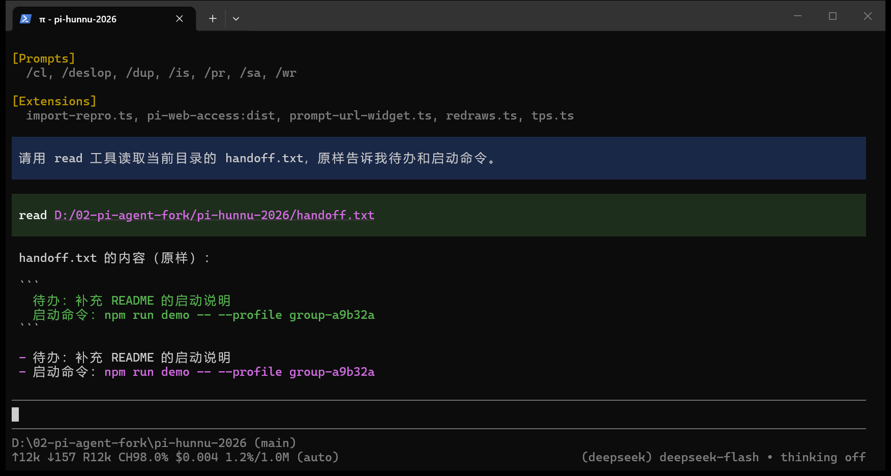
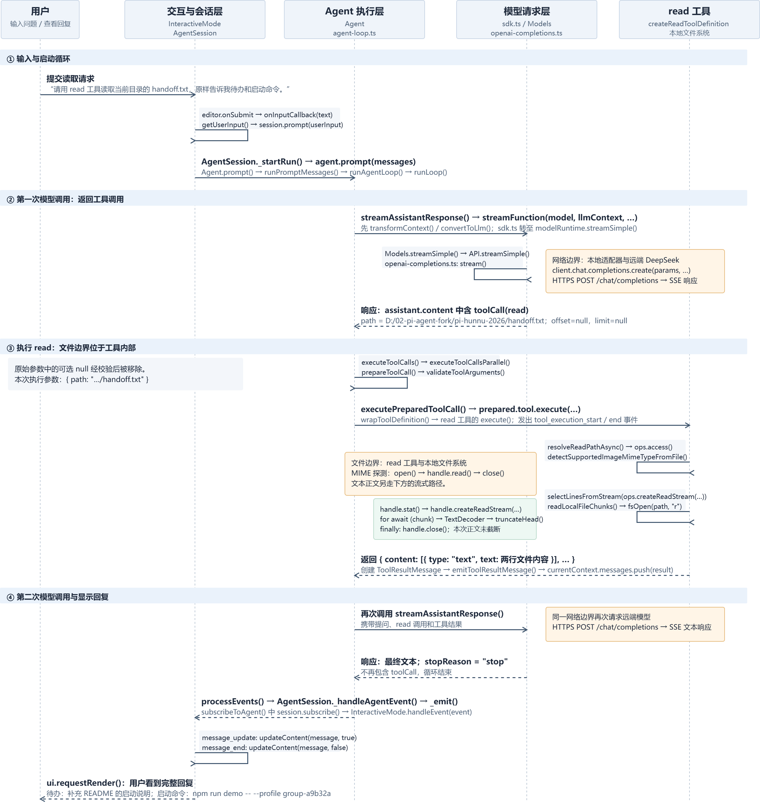
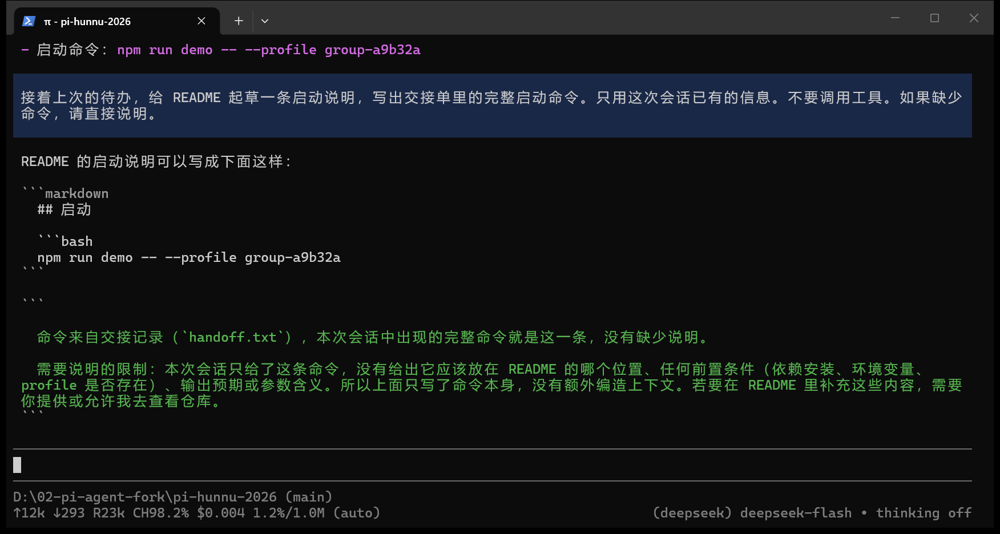
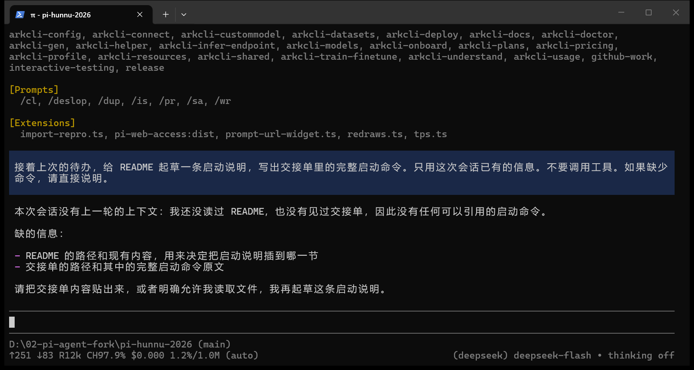
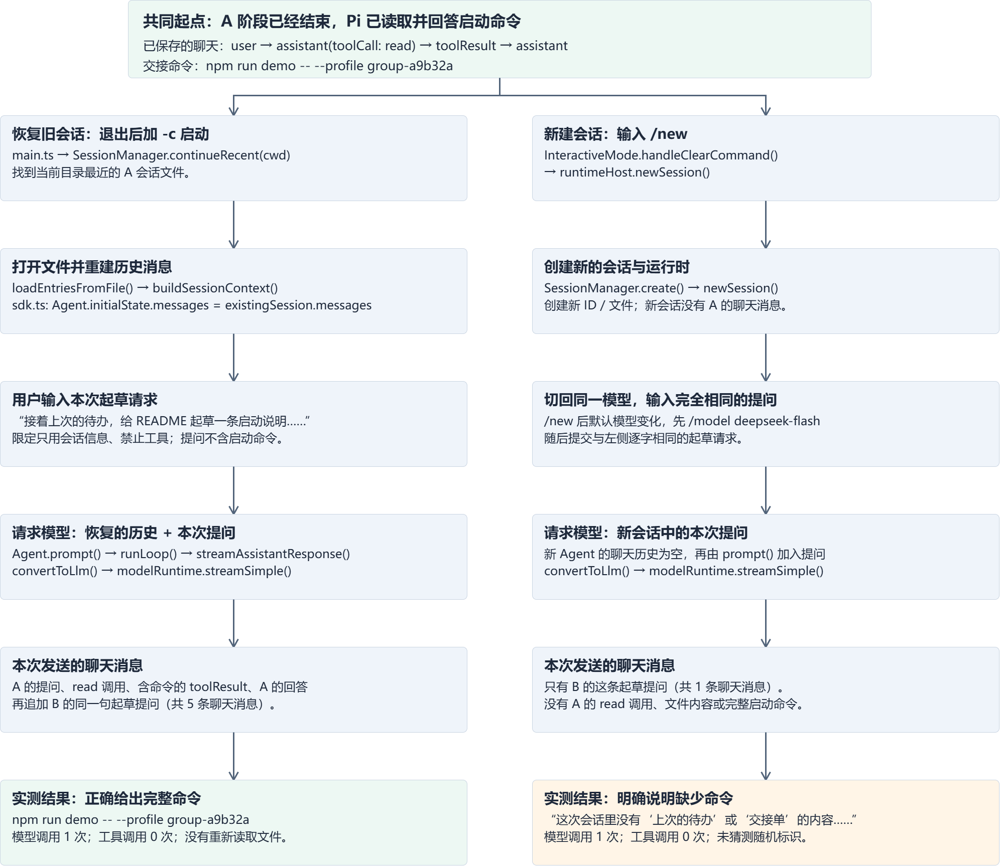

# 实践课5：Pi Agent工具调用与会话恢复

## 基本信息

| 项目 | 内容 |
| --- | --- |
| 姓名拼音 | maoenqi |
| GitHub | Mao123415 |
| 小组仓库 | [MangDui/pi-hunnu-2026](https://github.com/MangDui/pi-hunnu-2026) |
| 环境 | Windows、PowerShell、本地构建 Pi v1.5.2 |
| 模型 | deepseek / deepseek-flash，thinking off |
| 日期 | 2026-11-26 |

截图为对应实验会话在 Pi 中恢复显示的界面。

## A. 单轮交互与工具调用

### 1. 操作与结果

在 `D:\02-pi-agent-fork\pi-hunnu-2026` 准备 `handoff.txt`：

```text
待办：补充 README 的启动说明
启动命令：npm run demo -- --profile group-a9b32a
```

启动本地构建的 Pi：

```powershell
node .\packages\coding-agent\dist\cli.js
```

通过 `/model` 选择 `deepseek-flash`，输入以下问题，不透露启动命令：

> 请用 read 工具读取当前目录的 handoff.txt，原样告诉我待办和启动命令。

Pi 执行一次 read，读取 `D:/02-pi-agent-fork/pi-hunnu-2026/handoff.txt`。工具结果 `isError=false`，回答中包含完整的两行内容，并额外添加代码块和列表：

```text
待办：补充 README 的启动说明
启动命令：npm run demo -- --profile group-a9b32a
```



本轮共 **1 次用户输入、2 次模型调用、1 次 read 执行**：

```text
用户提问 → 模型返回 read 调用 → 工具返回文件内容
        → 工具结果加入上下文 → 再次请求模型 → 最终回答
```

消息记录见 [任务 A 证据](task-a-evidence.json)。第一条 assistant 消息以 `toolUse` 结束，工具结果之后的第二条 assistant 消息以 `stop` 结束。

### 2. 图一：代码级时序图



[draw.io 源文件](img/figure-1-tool-call.drawio)

### 3. 关键源码

路径均相对于源码仓库。

| 环节 | 源码位置与调用 |
| --- | --- |
| 输入入口 | `packages/coding-agent/src/modes/interactive/interactive-mode.ts:3325`：`onSubmit` 交出输入，主循环调用 `session.prompt(userInput)`。 |
| 会话进入 Agent | `packages/coding-agent/src/core/agent-session.ts:1982`：`this.agent.prompt(messages)`。 |
| 启动循环 | `packages/agent/src/agent.ts:382`：`Agent.prompt()` → `runPromptMessages()` → `runAgentLoop()`。 |
| 请求模型 | `packages/agent/src/agent-loop.ts:391`：`streamAssistantResponse()` 转换消息后调用 `streamFunction()`；SDK 转至 `modelRuntime.streamSimple()`。 |
| 网络边界 | `packages/ai/src/api/openai-completions.ts:385`：`client.chat.completions.create(…).withResponse()` 向远端 DeepSeek 请求，接收流式响应。 |
| 工具执行 | `packages/agent/src/agent-loop.ts:826`：`executePreparedToolCall()` 调用 `prepared.tool.execute()`，结果加入上下文后继续循环。 |
| 文件边界 | `packages/coding-agent/src/core/tools/read.ts:245`：路径解析、可读性检查、类型探测、文本读取。 |
| 显示回复 | `interactive-mode.ts:3649`、`:3685`：`message_update` 与 `message_end` 分支调用 `updateContent()`，再由 `ui.requestRender()` 刷新终端。 |

本次正文走**流式读取**：read 原始参数中的可选 `offset=null`、`limit=null` 经 `validateToolArguments()` 移除，随后进入 `selectLinesFromStream()`。默认 `readLocalFileChunks()` 使用 `fsOpen()`、`handle.createReadStream()`，最终关闭文件。MIME 探测另用 `handle.read()` 读取少量文件头字节；它与正文读取是两次不同的文件操作。

## B. 恢复旧会话与新建会话

### 1. 恢复原会话（-c）

退出 Pi，在同一目录按原命令加 `-c` 启动：

```powershell
node .\packages\coding-agent\dist\cli.js --offline -c
```

终端回放了 A 阶段的提问、read 记录和完整命令。输入：

> 接着上次的待办，给 README 起草一条启动说明，写出交接单里的完整启动命令。只用这次会话已有的信息。不要调用工具。如果缺少命令，请直接说明。

回答给出了 README 启动说明，包含以下完整命令，**未调用工具**：

```bash
npm run demo -- --profile group-a9b32a
```



### 2. 新建会话（/new）

输入 `/new`，界面显示 `New session started`，A 阶段记录消失。新建会话后模型回到默认配置，因此先执行 `/model deepseek-flash` 切回相同模型，再发送上面完全相同的问题。

回答开头为：

> 本次会话没有上一轮的上下文：我还没读过 README，也没有见过交接单，因此没有任何可以引用的启动命令。

模型明确说明缺少完整启动命令，**未调用工具**。



### 3. 对照记录

| 项目 | 恢复旧会话 | /new 新会话 |
| --- | --- | --- |
| 模型 | deepseek-flash | deepseek-flash |
| 是否有 A 阶段聊天历史 | 有 | 无 |
| 本轮模型调用 | 1 次 | 1 次 |
| 本轮工具调用 | 0 次 | 0 次 |
| 回答含完整命令 | 是 | 否，说明缺少命令 |
| 非缓存输入 token | 219 | 251 |
| 缓存读取 token | 11776 | 11520 |
| 输入合计 token | 11995 | 11771 |

输入合计为 `usage.input + usage.cacheRead`；本次 `cacheWrite=0`。新会话仍带系统指令和工具定义，不能把非缓存输入数量直接当作全部上下文大小。

完整回答与统计见 [任务 B 证据](task-b-evidence.json)。恢复分支没有重新读文件，却准确给出随机命令，支持它使用了已恢复的会话历史；新会话没有这些历史，因此缺少命令。

### 4. 图二：会话恢复对照图



[draw.io 源文件](img/figure-2-session-compare.drawio)

### 5. 关键源码

| 环节 | 源码位置与作用 |
| --- | --- |
| `-c` 找回文件 | `packages/coding-agent/src/main.ts:479` → `SessionManager.continueRecent()`，查找当前目录最近的会话。 |
| 恢复历史 | `core/session-manager.ts` 的 `loadEntriesFromFile()`、`buildSessionContext()` 读取并重建消息；`core/sdk.ts:409` 将 `existingSession.messages` 装入 Agent。 |
| `/new` 入口 | `interactive-mode.ts:3429` → `handleClearCommand()` → `runtimeHost.newSession()`。 |
| 创建新历史 | `core/agent-session-runtime.ts:226` 创建新 SessionManager 和运行时；`core/session-manager.ts:1065` 重置会话条目与分支。 |
| 再次请求模型 | `agent-loop.ts` 中 `streamAssistantResponse()` 转换当前消息，再交给模型适配器发送。 |

恢复分支发送 A 的提问、工具调用、工具结果、最终回答，以及 B 的本次提问；新会话的聊天部分只有 B 的本次提问。`-c` 的作用是重建历史并随新问题发送，`/new` 的作用是开始新的聊天历史。
